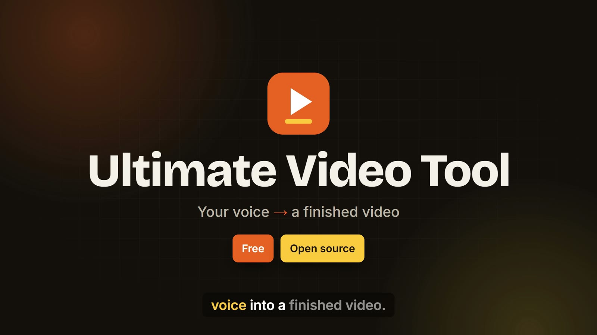
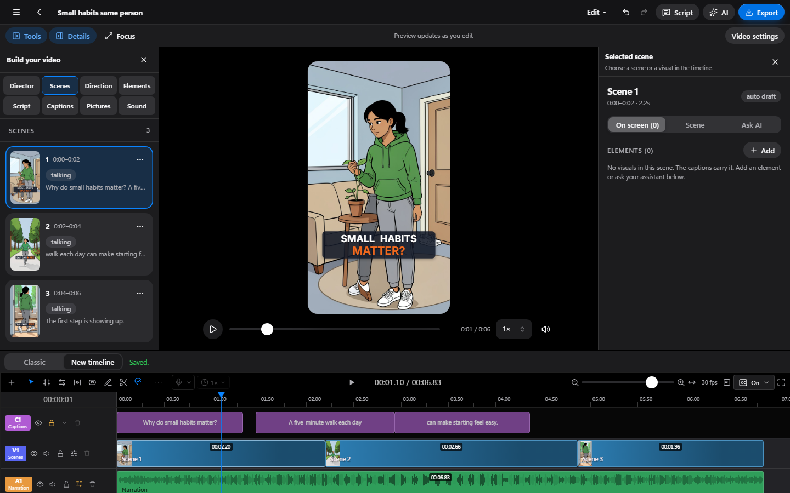
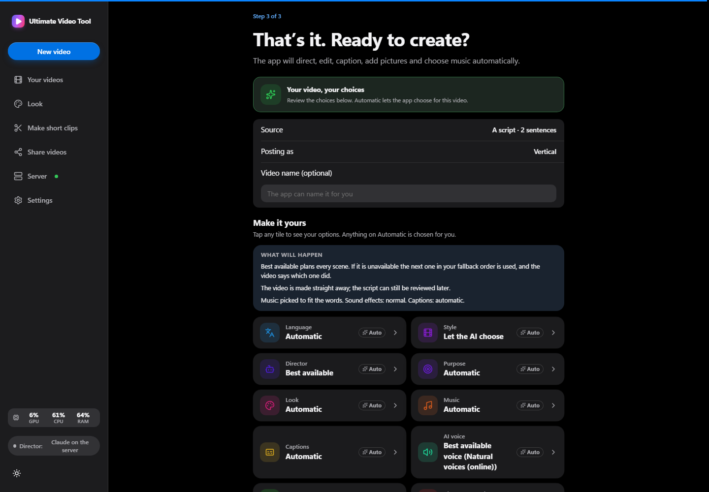
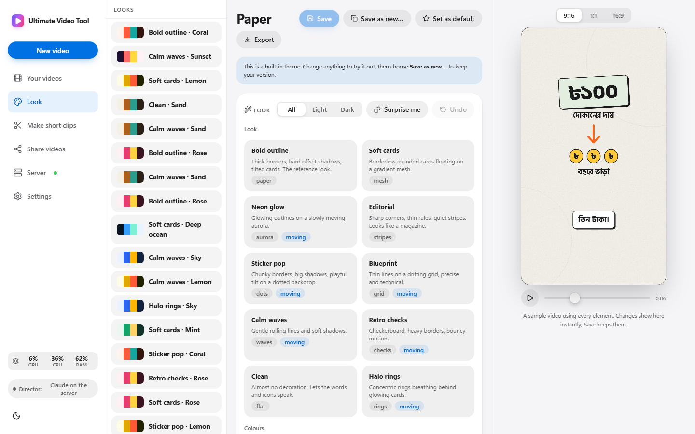
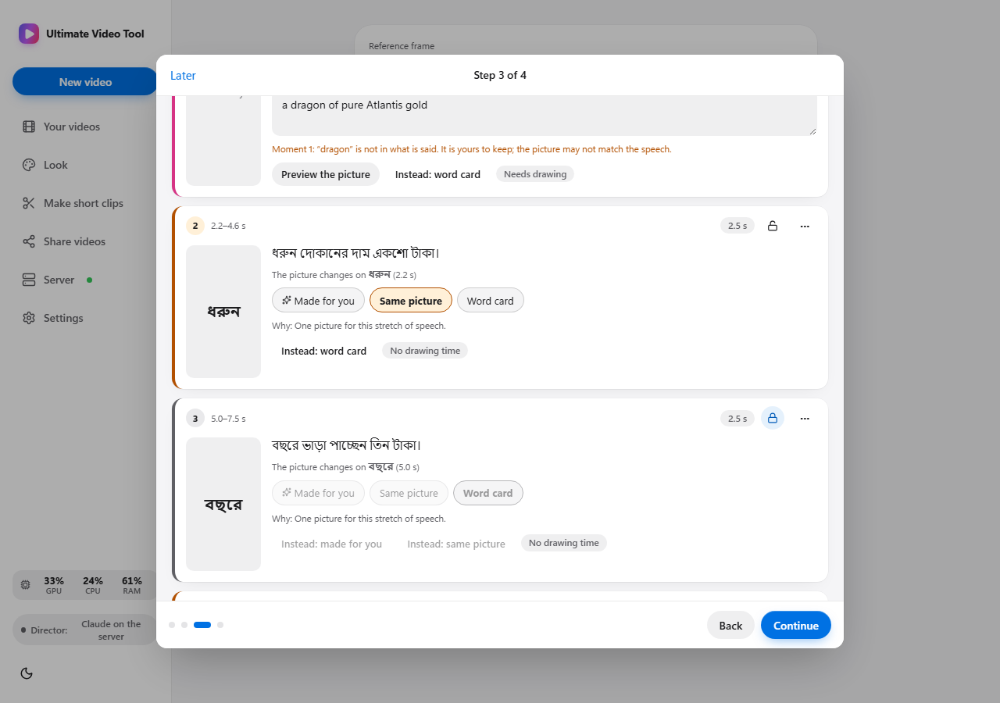

<div align="center">


# Ultimate Video Tool

**Talk, or type a script. Get a finished, edited video.**

**Status: beta (0.x).** It works end to end, but video quality and installs on new machines are still being proven. See the [status page](docs/STATUS.md).

A free, open-source video studio: an AI director plans every scene, finds the pictures,
designs the look and adds captions, music and sound. Then you can change anything by hand.

[Website](https://atanuroy911.github.io/ultimate-video-tool/) ·
[Launch video](https://atanuroy911.github.io/ultimate-video-tool/#launch) ·
[Download](https://github.com/atanuroy911/ultimate-video-tool/releases) ·
[Documentation](docs/README.md)

[](LICENSE)


[](https://github.com/atanuroy911/ultimate-video-tool/actions/workflows/ci.yml)

<a href="https://atanuroy911.github.io/ultimate-video-tool/#launch">
  
</a>

<sub>Voiced, word-timed and rendered by Ultimate Video Tool. Click to watch.</sub>

</div>

---

## What it does

You bring a voice recording, a typed script, or a link. Ultimate Video Tool:

1. **Cleans the audio.** It removes silences, "um"s and retakes, then times every word.
2. **Directs the video.** An AI director reads what is said and plans each scene, picking from 20+ scene types: big numbers, charts, timelines, checklists, quotes, device mockups, cartoons, full-screen pictures and more.
3. **Finds or makes the pictures.** It uses your own media first, then colour emoji, icons and drawn clipart. With a picture model available, it draws new images.
4. **Designs the look.** Each video gets a look, colours and fonts that fit its topic. Captions are timed to the word.
5. **Adds sound.** Music follows the mood and ducks under the voice. Sound effects land on the cuts.
6. **Checks its own work.** It looks at the rendered frames, finds text that is cut off, crowded or hard to read, and the moments where viewers would scroll away, then fixes them.
7. **Hands the video to you.** Tell the director what to change in plain words, or edit any element on a multitrack timeline: position, size, timing, motion and keyframes.

| Style | Best for |
|---|---|
| **Let the AI choose** | Anything. The director decides per video. |
| **Motion graphics** | Business, finance and tech explainers |
| **Infographic** | Numbers, comparisons and steps |
| **Picture-led reel** | Short stories and visual explanations |
| **Video + motion** | Talking-head videos, podcasts, video essays |
| **Stick figures** | Stories, humour and everyday scenes, acted out by a rigged stick figure |
| **Cartoon / storybook** | Characters on illustrated sets, for stories and lessons |
| **Emoji** | High-energy Shorts, Reels and TikToks |

It also cuts **short clips** from long recordings, writes a **publishing kit** (title, description, hashtags, cover) and can **post** to YouTube, Meta and TikTok from a queue.

## Screenshots

<table>
<tr>
<td width="50%"><br><sub><b>Editor.</b> Scenes, live preview, inspector and a multitrack timeline.</sub></td>
<td width="50%"><br><sub><b>New video.</b> Every choice is automatic until you change it.</sub></td>
</tr>
<tr>
<td><br><sub><b>Look.</b> 10 looks × 18 palettes, fonts, motion and captions, with a live preview.</sub></td>
<td><br><sub><b>Plan review.</b> See and change what the director decided before anything is drawn.</sub></td>
</tr>
</table>

## Choose who directs

The director is the AI that plans the video. One director handles a whole video, and every prompt and answer is shown in **Details → AI conversations**.

| Director | Needs |
|---|---|
| **Local AI** | [Ollama](https://ollama.com) on the server or anywhere on your network. Setup can install it and pick a model that fits your graphics card. |
| **Claude** | [Claude Code](https://claude.com/claude-code) signed in on the server or on your own computer. No API key. |
| **Codex** | The Codex CLI signed in on your computer |
| **Any API** | An Anthropic key, or any OpenAI-compatible service |
| **Rules only** | Nothing. Built-in rules make a complete video when no AI answers, and the video says so. |

**Best available** tries them in your fallback order.

## Use it from your AI assistant (MCP)

Video Tool is also an [MCP](https://modelcontextprotocol.io) server. Claude Code, Claude Desktop, Codex, Cursor, VS Code, Gemini CLI or any MCP client can create projects, plan scenes, fix transcript words, change the look, preview frames and render.

- **Settings → Use your own AI assistant** sets up each assistant with one click or one copy-paste.
- In this repository, `.mcp.json` already registers the `video-tool` server for Claude Code. Run `/vt-plan` to plan every video waiting for Claude.
- Remote assistants can use the token-protected HTTP endpoint: `vt-mcp --http --port 8766`.

## How it works

```text
 voice / script / link
          │
          ▼
 clean audio ─► cut silences & retakes ─► transcribe (GPU) ─► time every word
                                                                   │
                                                                   ▼
                    AI director (local AI · Claude · Codex · API · rules)
                    plans scenes, pictures, look, captions, sound
                                                                   │
                                                                   ▼
 final .mp4 ◄── render (HyperFrames) ◄── HTML composition ◄── frame & retention checks
```

Ultimate Video Tool comes as **two apps**:

- **Client**: the editor, a desktop app for Windows and Linux. It installs in seconds, with no Python and no models.
- **Server**: the pipeline, AI engines, voices and renderer. Put it on the same computer, or on a computer with a graphics card and edit from any laptop on your network. It manages its own Ollama, ComfyUI and models, and you choose which graphics cards it may use.

## Install

### Download (recommended)

Get the installers from [Releases](https://github.com/atanuroy911/ultimate-video-tool/releases):

| Download | What it is |
|---|---|
| **Ultimate Video Tool**: `.exe` · `.AppImage` · `.deb` | The editor (client) |
| **Ultimate Video Tool Server**: `.exe` · `.AppImage` · `.deb` | The processing server, with a management window |
| **Video Tool Engine**: `.zip` · `.tar.gz` · Docker image | A headless server for a GPU machine |

Install the server, open it, and follow the setup screen. It finds your graphics card, offers models that fit it, and downloads what it needs into its own folder. No administrator rights are needed. Then open the client and connect: on the same computer it finds the server by itself. From another computer, give it the server's address, and paste the server's key once (the server window has a **Copy key** button).

> The installers are not code-signed yet. Windows SmartScreen shows a one-time warning: choose **More info → Run anyway**.
>
> Coming from the earlier 1.0.0 download? Install over it. That release was numbered too early and is replaced by the 0.x versions. On Linux, install a `.deb` with `sudo apt install --allow-downgrades ./<file>.deb`.

### From source

Requires Git and FFmpeg. The scripts download their own Node, Python ([uv](https://docs.astral.sh/uv/)) and dependencies into a private folder. Nothing is installed system-wide.

```powershell
# Windows
git clone https://github.com/atanuroy911/ultimate-video-tool.git
cd ultimate-video-tool
./scripts/dev-install.ps1 -Role both
```

```sh
# Linux
git clone https://github.com/atanuroy911/ultimate-video-tool.git
cd ultimate-video-tool
bash scripts/dev-install.sh --role both
```

Use `-Role client -ServerUrl http://<server>:8790` to install only the editor against a remote server. See [docs/DEVELOPMENT-INSTALL.md](docs/DEVELOPMENT-INSTALL.md) for every option.

### What hardware?

- **The client** is light: any 64-bit Windows or Linux computer that runs a modern browser.
- **The server** runs without a graphics card, but slowly. Speech recognition runs on the CPU, and the director can be Claude, Codex or an API.
- **An NVIDIA card makes it fast.** It is developed and tested on a 6 GB laptop RTX 4050. Setup offers a small FLUX.2 Klein picture model sized for 6 GB cards, and larger ones for 12 GB and up. Generated video clips need a 12 GB card or 32 GB of RAM.

## Command line

Everything in the app is also a command, for scripts and agents. The app and the command line call the same code.

```sh
vt --help          # every command
vt system          # how busy the server is
vt gpu             # which graphics cards Video Tool may use
vt link <url>      # start a video from a link
vt-mcp             # run the MCP server (stdio)
```

## Repository layout

```text
client/
  studio/      the editor (React + TypeScript, Vite)
  desktop/     the client desktop app (Electron) and the Claude/Codex helper
server/
  vt/          the pipeline, director, API (FastAPI), CLI and MCP server (Python 3.11)
  renderer/    the HyperFrames render worker (Node)
  desktop/     the server's management window (Electron)
  design/      looks, palettes, fonts, icons, scene profiles
  assets/      bundled music, sound effects and clipart
third_party/   vendored Apache-2.0 projects
scripts/       install, build, QA and lab scripts
tests/         repository-level tests (server tests live in server/tests)
docs/          documentation and this project's website
```

## Documentation

- [docs/README.md](docs/README.md): where to start in the docs
- [docs/ROADMAP.md](docs/ROADMAP.md) and [docs/STATUS.md](docs/STATUS.md): the plan, and what is built, with evidence
- [docs/HANDOFF.md](docs/HANDOFF.md): how to work in this repository
- [docs/GLOSSARY.md](docs/GLOSSARY.md): what every word in the app means
- [docs/plans/](docs/plans/): detailed designs

## Contributing

Contributions are welcome: bug reports, Bangla and English test recordings, looks and palettes, scene types, docs and code. Read [CONTRIBUTING.md](CONTRIBUTING.md) first. By taking part you agree to follow the [Code of Conduct](CODE_OF_CONDUCT.md). To report a security problem, see [SECURITY.md](SECURITY.md). Please don't open a public issue for it.

## License

Ultimate Video Tool is released under the **[GNU Affero General Public License v3.0 or later](LICENSE)**. You may use, study, change and share it. If you distribute it, or run a modified version as a network service, you must offer your changes' source code under the same licence.

Parts of the editor timeline come from [OpenChatCut](https://github.com/0xsline/OpenChatCut) (AGPL-3.0-or-later). Bundled and downloaded components keep their own licences. Some optional models are non-commercial. See [THIRD-PARTY.md](THIRD-PARTY.md).
