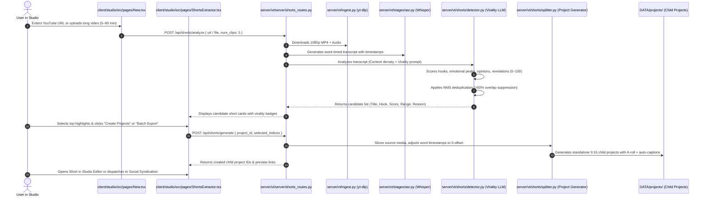

# AI YouTube Shorts Generator: Automated Viral Highlight Extractor & Multi-Shorts Engine

> **Reference & Foundation**:
> - [Anil-matcha/AI-Youtube-Shorts-Generator](https://github.com/Anil-matcha/AI-Youtube-Shorts-Generator) (MIT Licensed, cloned into `third_party/ai-youtube-shorts-generator`): Virality scoring criteria, 20-min chunking with overlap, content density classifier, hook sentence extraction, and NMS score deduplication.
> - **Video Tool Core**: Word-timed Whisper ASR (`server/vt/stages/asr.py`), face-tracking shot reframing (`server/vt/aroll.py`), multi-provider LLM engine with caching (`server/vt/ai/providers.py`), NVENC GPU acceleration (`server/vt/gpu.py`), and Studio timeline editor.

---

## 1. System Architecture & Workflow



---

## 2. Virality Scoring Framework & Prompt Strategy

Adapted from `third_party/ai-youtube-shorts-generator/shorts_generator/highlights.py`:

### Virality Evaluation Criteria:
1. **Hook Moments (Weight 25%)**: Opening statements that create intense curiosity ("The secret is...", "Nobody talks about...", "I was completely wrong about...").
2. **Emotional Peaks (Weight 20%)**: Genuine surprise, laughter, vulnerability, excitement, unscripted reactions.
3. **Opinion Bombs (Weight 15%)**: Counter-intuitive, polarizing viewpoints that provoke comments and debate.
4. **Revelation Moments (Weight 15%)**: Surprising facts, counter-intuitive data, or mindset shifts.
5. **Conflict / Tension (Weight 10%)**: Disagreement, challenge, or a problem tackled head-on.
6. **Quotable Lines (Weight 5%)**: Standalone quotes suitable for text overlays.
7. **Story Arc / Payoff (Weight 5%)**: A compact narrative with setup, turn, and satisfying payoff within 30–60 seconds.
8. **Practical Value (Weight 5%)**: Immediately actionable takeaway or life hack.

### Boundary Snapping:
- Highlights generated by raw LLMs can sometimes cut sentences mid-word.
- Video Tool snaps `start_time` and `end_time` to the nearest Whisper sentence/phrase boundaries with a 0.2s pause padding.

---

## 3. Sub-Module Breakdown

### 3.1 Backend: `server/vt/shorts/`
- **`server/vt/shorts/prompts.py`**:
  - `CONTENT_TYPE_PROMPT`: Classifies video type (podcast, interview, tutorial, lecture, commentary, vlog) and density (low, medium, high).
  - `VIRALITY_SYSTEM_PROMPT`: Structured schema instruction returning:
    ```json
    {
      "highlights": [
        {
          "title": "Why 99% Fail at AI",
          "start_time": 142.5,
          "end_time": 195.2,
          "score": 94,
          "hook_sentence": "Most people using ChatGPT are making this fatal mistake.",
          "virality_reason": "Strong contrarian hook with immediate actionable curiosity gap."
        }
      ]
    }
    ```
- **`server/vt/shorts/detector.py`**:
  - `chunk_transcript()`: 20-minute sliding windows with 60-second overlap for videos > 30 minutes.
  - `detect_highlights()`: Calls `vt.ai.providers.complete_json()` (with automatic fallback to local Ollama / Claude / OpenAI / Gemini).
  - `dedupe_highlights()`: NMS algorithm dropping highlights overlapping > 50% with higher-scoring moments.
  - `snap_to_sentences()`: Refines timestamps against Whisper word-level timing.
- **`server/vt/shorts/splitter.py`**:
  - `create_short_project(parent_pid, highlight, target_aspect="9:16")`:
    - Copies sliced media (lossless or re-encoded with `h264_nvenc`).
    - Filters transcript words to range `[start_time, end_time]` and shifts timestamps by `-start_time`.
    - Generates 9:16 project config with A-roll face tracking enabled (`options.aroll = True`).
    - Configures kinetic captions and auto-theme.

### 3.2 Server Endpoints: `server/vt/server/shorts_routes.py`
- `POST /api/shorts/detect`: Analyzes a YouTube link or existing project ID; streams progress via Job runner.
- `GET /api/projects/{pid}/shorts`: Returns detected highlights for a project.
- `POST /api/projects/{pid}/shorts/generate`: Slices selected highlights into new child projects.
- `POST /api/projects/{pid}/shorts/batch-export`: Slices and directly renders 9:16 vertical MP4s.

### 3.3 Studio Frontend: `client/studio/src/pages/ShortsExtractor.tsx`
- Mode selector in `client/studio/src/pages/New.tsx`: "✂️ Extract Shorts from YouTube/Video".
- Candidate Highlights View:
  - Viral Score pill (Color coded: 90+ Emerald, 80-89 Purple, 70-79 Blue).
  - Hook quote callout.
  - One-click audio/video range preview player.
  - "Open in Studio" button (opens full visual timeline editor).
  - "Export Video" button (renders final vertical video with NVENC).
  - "Post to Socials" button (queues into Multi-Channel Syndication).

---

## 4. Implementation Steps

1. **Step 1: Core Engine (`server/vt/shorts/prompts.py`, `server/vt/shorts/detector.py`)**
   - Port and modernize highlight prompts, chunking, and deduplication into `server/vt/shorts/`.
   - Integrate with `vt.ai.providers` for multi-LLM execution.
   - Add sentence boundary snapping with Whisper timestamps.

2. **Step 2: Project Slicer (`server/vt/shorts/splitter.py`)**
   - Create child project generator that slices media, re-bases timestamps, and creates valid `project.json` and `plan.json`.
   - Ensure NVENC GPU acceleration is used for video trimming.

3. **Step 3: Server API Integration (`server/vt/server/shorts_routes.py` & `server/vt/server/app.py`)**
   - Add background job execution for long video analysis.
   - Register endpoints in FastAPI app.

4. **Step 4: Frontend UI (`client/studio/src/pages/ShortsExtractor.tsx`)**
   - Build UI for browsing, auditioning, and generating shorts.
   - Wire into `client/studio/src/pages/New.tsx` and `client/studio/src/pages/Review.tsx`.

5. **Step 5: Testing & Verification**
   - Unit tests for detector, boundary snapping, and deduplication.
   - End-to-end test on sample project / audio.


---
**Update 2026-10-26.** The highlight picker should reuse the impact map of [PLAN-AUDIO-FIRST-DIRECTOR.MD](PLAN-AUDIO-FIRST-DIRECTOR.MD) (stress, sound events, arousal, structure) instead of its own keyword cues, and a short's opening must land an impact within 3 s: choose the clip start so the first impact is near the start, not mid-thought.
