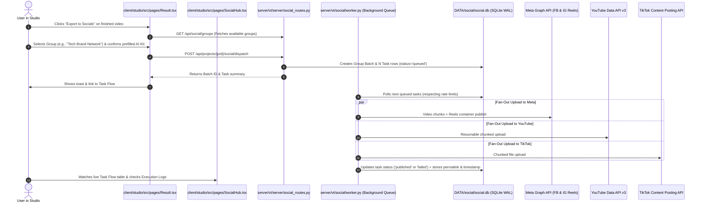

# Comprehensive Architecture & Implementation Plan: Multi-Channel Social Video Syndication & Task Flow

> **Inspiration & Codebase Lineage**:
> 1. [Freespirits/social-auto-engine](https://github.com/Freespirits/social-auto-engine) (SocialBlast AI): Multi-channel Graph API adapters, never-expiring token exchanges, company-grouped fan-out compose (`group_id`), and SQLite WAL persistence.
> 2. **VidiBot 4.0.0**: Batch task-flow table with concrete workbook rows per task, browser profile / platform binding, execution logs, and live progress state machine.

---

## 1. System Overview & The Fan-Out Workflow



---

## 2. Platform Adapter Architecture & Raw Code Foundations

All adapters inherit from `BaseSocialAdapter` in `server/vt/social/adapters/base.py`:

```python
class BaseSocialAdapter(ABC):
    platform: str

    @abstractmethod
    def upload_video(
        self,
        account: SocialAccount,
        video_path: Path,
        title: str,
        description: str,
        tags: list[str],
        progress_cb: Optional[Callable[[float, str], None]] = None,
    ) -> UploadResult:
        """Uploads video, tracks progress, and returns permalink + remote ID."""
        pass

    @abstractmethod
    def check_token(self, account: SocialAccount) -> bool:
        """Verifies if credentials/tokens are active; refreshes if needed."""
        pass
```

---

### 2.1 Facebook Pages & Reels Adapter (`server/vt/social/adapters/facebook.py`)
*Derived from `facebook_api.py` & `scripts/refresh_token.py` in `social-auto-engine`.*

#### Token Strategy (Never-Expiring Page Access Tokens)
Graph API Explorer tokens expire in 1 hour. We implement the exact two-tier token exchange from `refresh_token.py`:
1. Exchange short-lived token $\to$ Long-lived User Token (60 days) via `oauth/access_token?grant_type=fb_exchange_token`.
2. Query `GET /{user_id}/accounts` with the long-lived user token. Meta returns **Page Access Tokens that NEVER expire** unless permissions are revoked or the password is changed.

#### Video & Reels Upload Protocol
For 9:16 vertical videos under 90s, the adapter uploads to Facebook Reels:
1. **Initialize Upload Session**:
   ```http
   POST https://graph.facebook.com/v22.0/{page_id}/video_reels
   upload_phase=start
   access_token={page_token}
   ```
   Returns `video_id` and `upload_url`.
2. **Transfer Chunks**:
   Stream binary chunks to `upload_url` with header `offset` and `file_size`.
3. **Publish Reel**:
   ```http
   POST https://graph.facebook.com/v22.0/{page_id}/video_reels
   upload_phase=finish
   video_id={video_id}
   video_state=PUBLISHED
   description={title + hashtags}
   ```
4. Returns permalink: `https://www.facebook.com/reel/{video_id}`.

---

### 2.2 Instagram Reels Adapter (`server/vt/social/adapters/instagram.py`)
*Derived from `instagram_api.py` in `social-auto-engine`.*

Instagram Business Accounts are linked to a Facebook Page. Publishing follows the official **Two-Step Container Flow**:

1. **Step 1: Create Reel Media Container**:
   Because the video is local on the user's machine, the local Video Tool server exposes a temporary secure streaming route (`/api/social/stream/{token}/{filename}`) or uploads directly via resumable upload protocol:
   ```http
   POST https://graph.facebook.com/v22.0/{ig_user_id}/media
   media_type=REELS
   video_url={temporary_local_stream_url}
   caption={description + hashtags}
   share_to_feed=true
   access_token={page_token}
   ```
   Returns `container_id`.
2. **Step 2: Poll Container Status**:
   Query `GET https://graph.facebook.com/v22.0/{container_id}?fields=status_code,status` every 3 seconds until `FINISHED` (or `ERROR`).
3. **Step 3: Publish**:
   ```http
   POST https://graph.facebook.com/v22.0/{ig_user_id}/media_publish
   creation_id={container_id}
   ```
   Returns `id`.
4. Returns permalink: Query `GET /{id}?fields=permalink` $\to$ `https://www.instagram.com/reel/{code}/`.

---

### 2.3 YouTube Shorts & Videos Adapter (`server/vt/social/adapters/youtube.py`)
*Derived from `youtube_api.py` in `social-auto-engine`.*

#### Token Strategy
Standard Google OAuth 2.0 with `prompt=consent` and `access_type=offline`. The stored `refresh_token` generates fresh 1-hour `access_token`s automatically before upload.

#### Resumable Upload Protocol (Chunked for reliability on large videos):
1. **Initialize Session**:
   ```http
   POST https://www.googleapis.com/upload/youtube/v3/videos?uploadType=resumable&part=snippet,status
   Authorization: Bearer {access_token}
   Content-Type: application/json; charset=UTF-8
   X-Upload-Content-Length: {file_size}
   X-Upload-Content-Type: video/mp4

   {
     "snippet": {
       "title": title[:100],
       "description": description + "\n\n" + " ".join(tags),
       "tags": tags,
       "categoryId": "22"
     },
     "status": {
       "privacyStatus": visibility, # "public", "unlisted", "private"
       "selfDeclaredMadeForKids": false
     }
   }
   ```
   Returns HTTP 200 with `Location: {upload_url}`.
2. **Upload Chunks**:
   Stream in 5MB or 10MB chunks:
   ```http
   PUT {upload_url}
   Content-Range: bytes {start}-{end}/{total_bytes}
   ```
3. **Result**:
   YouTube auto-flags 9:16 vertical videos under 60 seconds as Shorts.
   Returns `video_id` $\to$ permalink: `https://www.youtube.com/shorts/{video_id}`.

---

### 2.4 TikTok Adapter (`server/vt/social/adapters/tiktok.py`)
*Derived from `tiktok_api.py` in `social-auto-engine`.*

1. **Initialize Video Upload**:
   ```http
   POST https://open.tiktokapis.com/v2/post/publish/video/init/
   Authorization: Bearer {tiktok_access_token}
   Content-Type: application/json; charset=UTF-8

   {
     "post_info": {
       "title": title[:150],
       "privacy_level": "PUBLIC_TO_EVERYONE",
       "disable_duet": false,
       "disable_comment": false,
       "disable_stitch": false
     },
     "source_info": {
       "source": "FILE_UPLOAD",
       "video_size": file_size,
       "chunk_size": chunk_size,
       "total_chunk_count": total_chunks
     }
   }
   ```
   Returns `publish_id` and `upload_url`.
2. **Upload Chunks**:
   Send multipart binary slices to `upload_url` with `Content-Range`.
3. **Status Check**:
   Query `POST https://open.tiktokapis.com/v2/post/publish/status_fetch/` with `{"publish_id": publish_id}` until `PUBLISH_COMPLETE`.

---

## 3. Database Engine & Schema (`DATA/social/social.db`)

We use a dedicated SQLite database in **WAL mode** (Write-Ahead Logging) located in `paths.DATA / "social" / "social.db"` to allow concurrent non-blocking reads from the Studio UI while the background worker processes uploads.

```sql
PRAGMA journal_mode=WAL;
PRAGMA synchronous=NORMAL;

-- 1. Connected Social Accounts
CREATE TABLE IF NOT EXISTS social_account (
    id              TEXT PRIMARY KEY,              -- e.g. "fb_page_12345", "yt_chan_6789"
    platform        TEXT NOT NULL,                 -- 'youtube', 'facebook', 'instagram', 'tiktok'
    name            TEXT NOT NULL,                 -- e.g. "Tech Tips Bangla"
    handle          TEXT,                          -- e.g. "@techtips"
    avatar_url      TEXT,
    credentials     TEXT NOT NULL,                 -- JSON with access_token, refresh_token, token_expiry, page_id
    is_active       INTEGER DEFAULT 1,
    created_at      TEXT DEFAULT CURRENT_TIMESTAMP,
    last_verified   TEXT
);

-- 2. Social Groups (Bundles of channels)
CREATE TABLE IF NOT EXISTS social_group (
    id              TEXT PRIMARY KEY,              -- e.g. "grp_brand_cluster"
    name            TEXT NOT NULL,                 -- "Main Brand Cluster"
    description     TEXT,                          -- "Primary Facebook Page, IG Reels, TikTok & Shorts"
    color           TEXT DEFAULT '#f26a1f',        -- UI badge color
    created_at      TEXT DEFAULT CURRENT_TIMESTAMP
);

-- 3. Group Membership (Many-to-Many)
CREATE TABLE IF NOT EXISTS group_account_map (
    group_id        TEXT NOT NULL REFERENCES social_group(id) ON DELETE CASCADE,
    account_id      TEXT NOT NULL REFERENCES social_account(id) ON DELETE CASCADE,
    PRIMARY KEY (group_id, account_id)
);

-- 4. Batch Fan-Out Runs (One export dispatched to a group)
CREATE TABLE IF NOT EXISTS social_batch (
    id              TEXT PRIMARY KEY,              -- UUID4
    project_id      TEXT NOT NULL,                 -- Video Tool project ID
    video_filename  TEXT NOT NULL,                 -- e.g. "export.mp4"
    group_id        TEXT REFERENCES social_group(id),
    group_name      TEXT NOT NULL,                 -- Snapshot of group name
    title           TEXT NOT NULL,
    description     TEXT,
    hashtags        TEXT,                          -- JSON array of tags
    total_tasks     INTEGER NOT NULL DEFAULT 0,
    status          TEXT DEFAULT 'running',        -- 'running', 'completed', 'partial_error'
    created_at      TEXT DEFAULT CURRENT_TIMESTAMP
);

-- 5. Individual Concrete Tasks (VidiBot row per target)
CREATE TABLE IF NOT EXISTS social_task (
    id              TEXT PRIMARY KEY,              -- UUID4 e.g. "task_01"
    batch_id        TEXT REFERENCES social_batch(id) ON DELETE CASCADE,
    project_id      TEXT NOT NULL,
    video_path      TEXT NOT NULL,                 -- Absolute path to exported mp4
    account_id      TEXT NOT NULL REFERENCES social_account(id),
    platform        TEXT NOT NULL,                 -- 'youtube', 'facebook', 'instagram', 'tiktok'
    account_name    TEXT NOT NULL,
    title           TEXT NOT NULL,
    description     TEXT,
    tags            TEXT,                          -- JSON array
    scheduled_for   TEXT,                          -- NULL = immediate
    
    -- Execution State
    status          TEXT DEFAULT 'queued',         -- 'queued', 'uploading', 'published', 'failed', 'cancelled'
    progress        REAL DEFAULT 0.0,              -- 0.0 to 1.0
    status_message  TEXT,                          -- e.g. "Uploading chunk 2/5 (40%)"
    permalink_url   TEXT,                          -- Live post URL
    remote_id       TEXT,                          -- Video/Post ID on platform
    error_message   TEXT,
    retries         INTEGER DEFAULT 0,
    started_at      TEXT,
    completed_at    TEXT,
    created_at      TEXT DEFAULT CURRENT_TIMESTAMP
);

CREATE INDEX IF NOT EXISTS idx_task_batch ON social_task(batch_id);
CREATE INDEX IF NOT EXISTS idx_task_status ON social_task(status);
CREATE INDEX IF NOT EXISTS idx_task_created ON social_task(created_at DESC);
```

---

## 4. UI / UX Design Specifications

### 4.1 "Publish to Socials" on the Finished Video Page (`Result.tsx`)
Right below the video export player and AI Kit, an interactive card:

```
┌────────────────────────────────────────────────────────────────────────┐
│  🚀 Publish Video to Social Channels                                   │
├────────────────────────────────────────────────────────────────────────┤
│  Target Social Group:                                                  │
│  [ Select Group: Main Brand Cluster (4 Channels)              ▼ ]     │
│  Channels in this group:                                               │
│  [f] Facebook (Tech Daily Page)    [ig] Instagram (@techdaily.reels)  │
│  [yt] YouTube (@techdaily)         [tt] TikTok (@techdaily)            │
│                                                                        │
│  Post Metadata:                                                        │
│  Title:       [ Make Your First Dollar with AI in 7 Days             ] │
│  Description: [ Full breakdown on the practical steps to start...    ] │
│  Hashtags:    [ #AI #Productivity #Shorts #Tech                      ] │
│                                                                        │
│  Schedule:                                                             │
│  (●) Publish Immediately      (○) Schedule for later: [ 2026-10-25 18:00 ]
│                                                                        │
│  [ 🚀 Dispatch to 4 Platforms ]          [ Customize per Platform ]   │
└────────────────────────────────────────────────────────────────────────┘
```
- Clicking **"Dispatch to 4 Platforms"** immediately creates the batch and tasks in SQLite, starts background workers, and shows a toast:
  > *"Dispatched 4 upload tasks to 'Main Brand Cluster'. [View Live Task Flow →]"*

---

### 4.2 Central Social Hub (`client/studio/src/pages/SocialHub.tsx`)
Accessible via the sidebar / navigation at `/social`:

#### Tab 1: Task Flow (Concrete Tasks Table — Inspired by VidiBot)
```
┌────────────────────────────────────────────────────────────────────────────────────────────────────────────────────────┐
│  Task Flow  ·  Execution Logs  ·  Connected Accounts & Groups                                                          │
├────────────────────────────────────────────────────────────────────────────────────────────────────────────────────────┤
│  [ Filter: All Platforms ▼ ] [ Status: All ▼ ] [ Search tasks...       ]   [ Start Flow ] [ Refresh ] [ Clean Completed]│
├─────────┬───────────────────┬──────────────┬──────────────┬────────────────────────┬─────────────┬─────────────────────┤
│ Task ID │ Video / Project   │ Platform     │ Account/Page │ Status                 │ Time        │ Actions             │
├─────────┼───────────────────┼──────────────┼──────────────┼────────────────────────┼─────────────┼─────────────────────┤
│ #1042   │ 7 Days to Make... │ YouTube      │ @techdaily   │ 🟢 Published           │ 01:15 AM    │ [🔗 View Video]     │
│ #1043   │ 7 Days to Make... │ Instagram    │ @techdaily   │ 🟢 Published           │ 01:16 AM    │ [🔗 View Reel]      │
│ #1044   │ 7 Days to Make... │ Facebook     │ Tech Daily   │ 🟡 Uploading (65%)     │ 01:17 AM    │ [⏹ Cancel]          │
│ #1045   │ 7 Days to Make... │ TikTok       │ @techdaily   │ 🔴 Failed (Rate limit) │ 01:17 AM    │ [🔄 Retry] [Detail] │
└─────────┴───────────────────┴──────────────┴──────────────┴────────────────────────┴─────────────┴─────────────────────┘
```

#### Tab 2: Execution Logs & History
- Comprehensive audit table of every past video upload.
- Filter by date range, platform, or project.
- Clickable links straight to live videos on YouTube, Facebook, Instagram, and TikTok.
- Clickable error drawer displaying full API response payloads and suggested resolutions.

#### Tab 3: Connected Accounts & Groups Builder
- Cards for **Facebook Pages**, **Instagram Accounts**, **YouTube Channels**, and **TikTok Profiles**.
- **Group Builder**:
  - `[ + Create New Social Group ]`
  - Name: "Client B - Lifestyle Network"
  - Checkboxes to associate any connected channels.

---

## 5. Background Task Engine (`server/vt/social/worker.py`)

A singleton background worker running inside the FastAPI server process (leveraging `asyncio` and `server/vt/server/jobs.py`):
1. **Concurrency Pool**: 2 concurrent uploads at a time to prevent saturating bandwidth.
2. **Platform Rate Limiter**:
   - Meta: Max 5 concurrent uploads.
   - Instagram: 25 publishes per 24 hours per account.
   - YouTube: 100 uploads per day quota.
   - TikTok: 6 upload initializations per minute.
3. **Resiliency**:
   - Automatic exponential retry on network glitches (up to 3 retries).
   - If one platform fails (e.g. TikTok temporary timeout), Facebook, YouTube, and Instagram are unaffected and publish successfully.

---

## 6. Phased Implementation Roadmap

### Phase 1: Core Social Backend & Database
1. Create `server/vt/social/models.py` with Pydantic models for `SocialAccount`, `SocialGroup`, `SocialBatch`, and `SocialTask`.
2. Create `server/vt/social/db.py` handling SQLite WAL connection, migrations, and CRUD operations.
3. Create `server/vt/social/worker.py` for background job execution and status updates.
4. Implement `server/vt/social/adapters/mock.py` so the complete flow can be tested end-to-end without live credentials.

### Phase 2: Live Platform Adapters
1. `server/vt/social/adapters/facebook.py`: Meta Graph API video & Reels upload + token refresh.
2. `server/vt/social/adapters/instagram.py`: Two-step container flow for Instagram Reels.
3. `server/vt/social/adapters/youtube.py`: YouTube Data API v3 resumable chunked upload.
4. `server/vt/social/adapters/tiktok.py`: TikTok Content Posting API chunked upload.

### Phase 3: REST API Endpoints (`server/vt/server/social_routes.py`)
1. Account management: `GET /api/social/accounts`, `POST /api/social/accounts/connect/{platform}`, `DELETE /api/social/accounts/{id}`.
2. Group management: `GET /api/social/groups`, `POST /api/social/groups`, `DELETE /api/social/groups/{id}`.
3. Dispatch & Queue: `POST /api/projects/{pid}/social/dispatch`, `GET /api/social/tasks`, `POST /api/social/tasks/{id}/retry`, `POST /api/social/tasks/{id}/cancel`.
4. Logs & History: `GET /api/social/logs`.

### Phase 4: Studio UI Integration
1. Update `client/studio/src/pages/Result.tsx` with the "Publish to Social Group" modal & dispatch trigger.
2. Create `client/studio/src/pages/SocialHub.tsx` with:
   - Task Flow Table (live status badges, animated progress bars, retry buttons).
   - Execution Logs Table (direct post links, timestamps, error inspection).
   - Accounts & Groups Manager.
3. Register `/social` in `client/studio/src/main.tsx` and add icon to `client/studio/src/Shell.tsx`.
4. Add English and Bengali translations to `client/studio/src/i18n.ts`.

### Phase 5: Verification & Quality Assurance
1. Test dispatching a rendered project to a mock group of 4 channels (YouTube, TikTok, Facebook, Instagram).
2. Validate task transitions: `queued` $\to$ `uploading (25%..75%)` $\to$ `published`.
3. Validate error handling: Simulate platform rejection $\to$ task marked `failed`, remaining tasks succeed, retry button retries failed task.
4. Verify execution logs persist accurate timestamps and permalinks.
